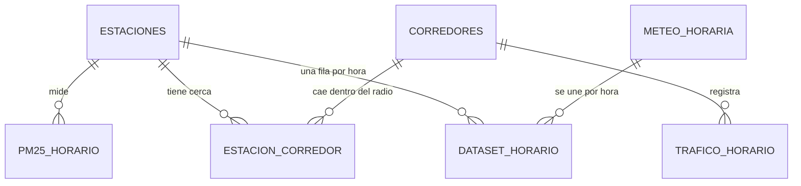

# Modelo de Datos y Contrato de Datos

Los archivos de PM2.5 son provisionales hasta descargar el primer archivo real de SIATA. Los de tráfico siguen el diccionario oficial de 2022 (debo revisar info más reciente)

## Diagrama de relaciones
(El diagrama tiene en cuenta extracción de data de open-meteo, lo cual todavía se sigue estudiando y no es definitivo)

El archivo final `dataset_horario` se construye uniendo, por hora y estación, el PM2.5, el tráfico agregado de los corredores cercanos y la meteorología.

## Resumen de archivos

| Archivo | Tipo | Origen | Granularidad | Clave |
|---|---|---|---|---|
| `trafico_horario.csv` | crudo | datos.gov.co (SIMM) | hora × carril | `fecha_trafico` + `corredor_sentido` + `carril` + `tipo_subsistema` (propuesta, verificar) |
| `pm25_horario.csv` | crudo, provisional | SIATA / AMVA | hora × estación | `timestamp` + `station_id` |
| `meteo_horaria.csv` | crudo | Open-Meteo | hora × punto | `time` + `latitude` + `longitude` |
| `estaciones.csv` | derivado | catálogo SIATA | estación | `station_id` |
| `corredores.csv` | derivado | `trafico_horario.csv` | corredor-sentido | `corredor_sentido` |
| `estacion_corredor.csv` | derivado | cruce espacial | par estación-corredor | `station_id` + `corredor_sentido` |
| `dataset_horario.parquet` | derivado (final) | integración | hora × estación × radio | `timestamp_hora` + `station_id` + `radio_m` |

## 1. `trafico_horario.csv` (crudo)

| Columna | Tipo | Significado | Reglas / relación |
|---|---|---|---|
| `fecha_trafico` | timestamp | Fecha y hora del registro | No nulo. Las columnas de calendario de la fuente se recalculan desde esta |
| `corredor` | string | Corredor vial | |
| `sentido` | string | Sentido de circulación | |
| `corredor_sentido` | string | Corredor + sentido | **Llave hacia `corredores.csv`** |
| `carril` | string | Carril del dispositivo | |
| `tipo_subsistema` | string | `ARS`, `CCTV` o `FT` (fotodetección) | Solo esos valores |
| `operacion` | string | Flujo continuo, semi o interrumpido | |
| `intensidad` | int | Vehículos por hora | ≥ 0 |
| `categoria_1` | int | Vehículos de 0 a 6 m, veh/h | ≥ 0 |
| `categoria_2` | int | Vehículos de 6 a 12 m, veh/h | ≥ 0 |
| `categoria_3` | int | Vehículos de más de 12 m, veh/h | ≥ 0 |
| `categoria_4` | int | Motos, veh/h | Solo ARS fase III; nulo en el resto es esperado |
| `velocidad` | float | Velocidad promedio de la hora, km/h | 0–150 |
| `ocupacion` | float | % de la hora que los vehículos ocuparon la zona de conteo | 0–100 |
| `latitud` | float | Según el diccionario, coordenada X en Magna Sirgas | **Ambigua: confirmar si son grados o metros** |
| `longitud` | float | Según el diccionario, coordenada Y en Magna Sirgas | **Confirmar nombres y orden** |
| `identificador_fv` | bool | F si el día tuvo registros en menos del 80 % del tiempo; V si no | Se usa para filtrar |
| `codigo_comuna` | int | Código de la comuna o corregimiento | |
| `nombre_comuna` | string | Nombre de la comuna o corregimiento | |

## 2. `pm25_horario.csv` (crudo, provisional)

| Columna | Tipo | Significado | Reglas / relación |
|---|---|---|---|
| `timestamp` | timestamp | Hora de la medición | No nulo |
| `station_id` | string | Identificador de estación | **Llave hacia `estaciones.csv`** |
| `pm25` | float | PM2.5, µg/m³ | 0–500; norma diaria nacional: 37 µg/m³ |
| `quality_flag` | string | Marca de validación de la fuente | Por confirmar |

## Contrato de datos: frecuencia y cambios de fuente (estimación inicial, estudio en primera fase)

| Fuente | Frecuencia de actualización | Si cambia la fuente |
|---|---|---|
| Tráfico (SIMM) | Mensual | Si cambian columnas, tipos o unidades, la ejecución falla antes de publicar; se pondrian en cuarentena filas fuera de rango y se marca el mes como incompleto si faltan datos |
| PM2.5 (SIATA/AMVA) | Horaria en origen (por confirmar..aun debo revisar) | Si cambia la ruta o el formato, se usa la última copia validada con su fecha y se documenta el corte |
| Meteorología (Open-Meteo o windy este no va para la pregunta inicial por lo que sigo buscando fuentes) | Diaria, con retraso de días | Si cambian variables o licencia, se detiene y se reevalúa |

