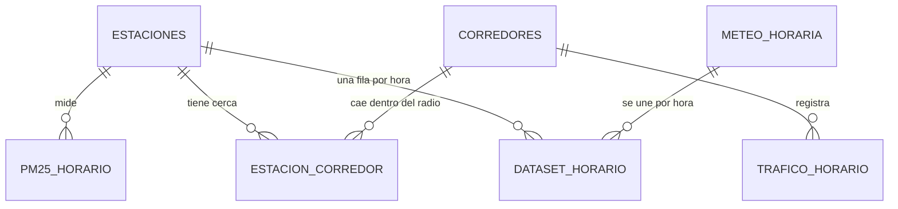

# Modelo de Datos y Contrato de Datos

Este es un **dataset**, no una base de datos. Cada archivo se describe con sus columnas, tipos, significado y relaciones.

<!-- Los archivos de PM2.5 son provisionales hasta descargar el primer archivo real de SIATA. Los de tráfico siguen el diccionario oficial de 2022 (debo revisar info más reciente) -->

## Convenciones

- Columnas en `snake_case`, sin tildes.
- Marcas de tiempo en zona horaria `America/Bogota`, formato ISO 8601.
- Tipos: `string`, `int`, `float`, `bool`, `date`, `timestamp`.
- **Crudo** (`raw`): tal como llega de la fuente. **Derivado**: se genera con código y es reconstruible.

## Diagrama de relaciones

El archivo final `dataset_horario` se construye uniendo, por hora y estación, el PM2.5, el tráfico agregado de los corredores cercanos y la meteorología.

## Resumen de archivos

| Archivo | Tipo | Origen | Granularidad | Clave |
|---|---|---|---|---|
| `trafico_horario.csv` | crudo | datos.gov.co (SIMM) | hora × carril | `fecha_trafico` + `corredor_sentido` + `carril` + `tipo_subsistema` (propuesta, verificar) |
| `pm25_horario.csv` | crudo, provisional | SIATA / AMVA | hora × estación | `timestamp` + `station_id` |
| `meteo_horaria.csv` | crudo | Open-Meteo | hora × punto | `time` + `latitude` + `longitude` |
| `estaciones.csv` | derivado | catálogo SIATA | estación | `station_id` |
| `corredores.csv` | derivado | `trafico_horario.csv` | corredor-sentido | `corredor_sentido` |
| `estacion_corredor.csv` | derivado | cruce espacial | par estación-corredor | `station_id` + `corredor_sentido` |
| `dataset_horario.parquet` | derivado (final) | integración | hora × estación × radio | `timestamp_hora` + `station_id` + `radio_m` |

## 1. `trafico_horario.csv` (crudo)

| Columna | Tipo | Significado | Reglas / relación |
|---|---|---|---|
| `fecha_trafico` | timestamp | Fecha y hora del registro | No nulo. Las columnas de calendario de la fuente se recalculan desde esta |
| `corredor` | string | Corredor vial | |
| `sentido` | string | Sentido de circulación | |
| `corredor_sentido` | string | Corredor + sentido | **Llave hacia `corredores.csv`** |
| `carril` | string | Carril del dispositivo | |
| `tipo_subsistema` | string | `ARS`, `CCTV` o `FT` (fotodetección) | Solo esos valores |
| `operacion` | string | Flujo continuo, semi o interrumpido | |
| `intensidad` | int | Vehículos por hora | ≥ 0 |
| `categoria_1` | int | Vehículos de 0 a 6 m, veh/h | ≥ 0 |
| `categoria_2` | int | Vehículos de 6 a 12 m, veh/h | ≥ 0 |
| `categoria_3` | int | Vehículos de más de 12 m, veh/h | ≥ 0 |
| `categoria_4` | int | Motos, veh/h | Solo ARS fase III; nulo en el resto es esperado |
| `velocidad` | float | Velocidad promedio de la hora, km/h | 0–150 |
| `ocupacion` | float | % de la hora que los vehículos ocuparon la zona de conteo | 0–100 |
| `latitud` | float | Según el diccionario, coordenada X en Magna Sirgas | **Ambigua: confirmar si son grados o metros** |
| `longitud` | float | Según el diccionario, coordenada Y en Magna Sirgas | **Confirmar nombres y orden** |
| `identificador_fv` | bool | F si el día tuvo registros en menos del 80 % del tiempo; V si no | Se usa para filtrar |
| `codigo_comuna` | int | Código de la comuna o corregimiento | |
| `nombre_comuna` | string | Nombre de la comuna o corregimiento | |

## 2. `pm25_horario.csv` (crudo, provisional)

| Columna | Tipo | Significado | Reglas / relación |
|---|---|---|---|
| `timestamp` | timestamp | Hora de la medición | No nulo |
| `station_id` | string | Identificador de estación | **Llave hacia `estaciones.csv`** |
| `pm25` | float | PM2.5, µg/m³ | 0–500; norma diaria nacional: 37 µg/m³ |
| `quality_flag` | string | Marca de validación de la fuente | Por confirmar |

## 3. `meteo_horaria.csv` (crudo)

| Columna | Tipo | Significado | Reglas / relación |
|---|---|---|---|
| `time` | timestamp | Hora (pedir `timezone=America/Bogota`) | Se une con `timestamp_hora` |
| `latitude`, `longitude` | float | Punto de la grilla | |
| `temperature_2m` | float | Temperatura a 2 m, °C | |
| `relative_humidity_2m` | float | Humedad relativa, % | 0–100 |
| `precipitation` | float | Precipitación, mm | ≥ 0 |
| `wind_speed_10m` | float | Viento a 10 m, km/h (unidad por defecto) | ≥ 0 |
| `wind_direction_10m` | float | Dirección del viento, grados | 0–360 |
| `surface_pressure` | float | Presión en superficie, hPa | |

Los nombres de variables siguen la documentación de Open-Meteo y deben probarse contra la API antes de congelarse.

## 4. `estaciones.csv` (derivado)

| Columna | Tipo | Significado | Reglas / relación |
|---|---|---|---|
| `station_id` | string | Identificador único | Clave primaria |
| `station_name` | string | Nombre | |
| `station_type` | string | `trafico` o `poblacional` | Según los informes de SIATA |
| `municipio` | string | Municipio | Solo Medellín |
| `lat`, `lon` | float | Ubicación | Convertir a sistema métrico antes de medir distancias |

## 5. `corredores.csv` (derivado)

| Columna | Tipo | Significado | Reglas / relación |
|---|---|---|---|
| `corredor_sentido` | string | Corredor + sentido | Clave primaria |
| `x`, `y` | float | Coordenada representativa (promedio de sus dispositivos) | Mismo sistema que `estaciones` |
| `codigo_comuna` | int | Comuna principal | |
| `n_dispositivos` | int | Dispositivos usados en el promedio | |

## 6. `estacion_corredor.csv` (derivado, tabla puente)

Resuelve la relación muchos a muchos entre estaciones y corredores.

| Columna | Tipo | Significado | Reglas / relación |
|---|---|---|---|
| `station_id` | string | Estación | Llave hacia `estaciones.csv` |
| `corredor_sentido` | string | Corredor | Llave hacia `corredores.csv` |
| `distancia_m` | float | Distancia en metros | ≥ 0. El radio (500, 1.000, 2.000 m) se aplica al integrar |

## 7. `dataset_horario.parquet` (derivado, final)

Una fila por hora, estación y radio.

| Columna | Tipo | Significado | Reglas / relación |
|---|---|---|---|
| `timestamp_hora` | timestamp | Hora truncada | Parte de la clave |
| `station_id` | string | Estación | Parte de la clave |
| `radio_m` | int | Radio de cruce (500, 1000, 2000) | Parte de la clave |
| `pm25` | float | PM2.5, µg/m³ | |
| `trafico_intensidad_media` | float | Promedio de `intensidad` de corredores dentro del radio | Solo registros con `identificador_fv = V` |
| `trafico_velocidad_media` | float | Promedio de `velocidad`, km/h | |
| `n_corredores` | int | Corredores con dato válido | ≥ 0; si es 0, el tráfico queda nulo |
| `temperature_2m`, `relative_humidity_2m`, `precipitation`, `wind_speed_10m`, `wind_direction_10m`, `surface_pressure` | float | Meteorología de la hora | Ver sección 3 |
| `hora_dia` | int | Hora local, 0–23 | Derivada |
| `dia_semana` | int | 1 (lunes) a 7 (domingo) | Derivada |
| `par_valido` | bool | Verdadero si hay PM2.5, tráfico y meteorología | Base del KPI de cobertura |

## Contrato de datos: frecuencia y cambios de fuente

| Fuente | Frecuencia de actualización | Si cambia la fuente |
|---|---|---|
| Tráfico (SIMM) | Mensual | Si cambian columnas, tipos o unidades, la ejecución falla antes de publicar; se cuarentenan filas fuera de rango y se marca el mes como incompleto si faltan datos |
| PM2.5 (SIATA/AMVA) | Horaria en origen (por confirmar..revisar) | Si cambia la ruta o el formato, se usa la última copia validada con su fecha y se documenta el corte |
| Meteorología (Open-Meteo) | Diaria, con retraso de días | Si cambian variables o licencia, se detiene y se reevalúa |

Cada cambio aceptado sube la versión del contrato (`v1.0` a `v1.1`) y queda en el historial de Git. Los datos descargados se conservan con su fecha de descarga para reproducir resultados previos.
